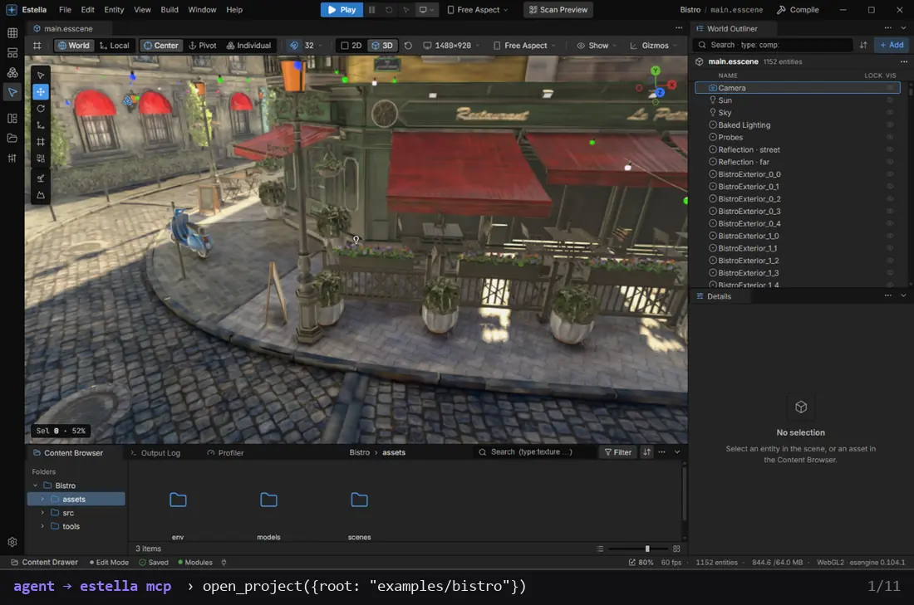
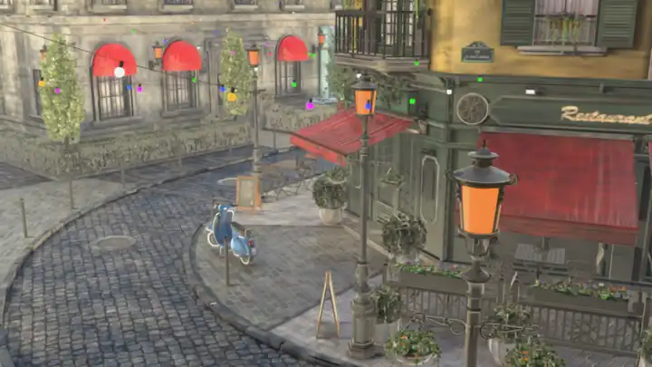

<div align="center">


# Estella

**A 2D and 3D game engine whose editor is an MCP server.**<br/>
Your AI agent builds the game with the same 167 tools the editor's own UI uses —
then ships it to the web, mini-game platforms, playable ads, desktop and native mobile.

[](https://github.com/esengine/estella/actions/workflows/build.yml)
[](LICENSE)
[](https://github.com/esengine/estella/releases)
[](https://estellaengine.com/docs/agents/mcp/)
[](https://estellaengine.com/docs/publishing/overview/)
[](https://deepwiki.com/esengine/estella)

[Website](https://estellaengine.com) • [Your agent drives the editor](#your-agent-drives-the-editor) • [Why Estella](#why-estella-when-unity-and-unreal-have-mcp-too) • [Getting Started](#getting-started) • [Documentation](https://estellaengine.com/docs) • [Discord](https://discord.gg/sAX6PXZ9) • [QQ群: 481923584](https://qm.qq.com/q/BONa5LXQ0U)

<br/>



<sub><i>Every frame is one MCP tool call into the editor, captured as it happened — no mouse involved.</i></sub>

</div>

## Your agent drives the editor

The Estella editor speaks the **Model Context Protocol**. Connect Claude Code, Cursor,
Codex or any MCP client, and the agent works inside the real editor rather than
around it:

- **It builds** — creates projects, spawns entities from the editor's own Create catalog,
  writes component fields, makes prefabs, paints tilemaps, writes and type-checks scripts.
- **It looks** — takes screenshots of the viewport and the running game, replays a frame
  draw by draw, compares the game with reference images, and audits what a scene's look lacks.
- **It plays** — enters Play mode, steps time deterministically, sends input and clicks
  UI by name, runs scripted playtests, then reads the running world back.
- **It makes assets** — images, sound effects, music and 3D models, each answered with
  a picture of what it made.
- **It ships** — reads project health, exports the game, and drives a build running on a
  connected phone.

Every call goes through the editor's command surface: each one is **one undo step**,
you watch it happen in the window, and you can take the mouse back at any time. The
editor starts **read-only**; an agent edits only after you allow it in
*Window → Connect AI Tools…*, which also writes the client's MCP config for you.

| Group | What the agent gets |
|---|---|
| core | scene tree, entities, components, play / step / input, screenshots, logs, undo |
| `assets` · `prefab` · `authoring` | asset documents and import settings, tilemaps, prefabs and variants, physics bodies, UI events |
| `look` · `render` | reference images beside the game, light and field sweeps, frame capture and replay, shadows, LOD, bakes |
| `code` · `project` | scripts, symbol search, type-check, project settings, health, export |
| `image` · `sound` · `modeling` | draw sprites and textures, compose sound and music, build 3D models from steps |
| `play` · `view` · `device` | gamepads, time scale, scripted playtests, editor view, and a game running on a connected phone |

→ [Connecting an agent](https://estellaengine.com/docs/agents/mcp/)

## Why Estella, when Unity and Unreal have MCP too?

An MCP server can be bolted onto any editor. What an agent can actually get done
depends on what sits behind it.

- **The protocol is the editor, not a plugin on it.** The 167 tools call the pipelines the
  editor's own menus, inspector and toolbar run, so an agent's edit is the edit a person
  would have made, and undoes the same way. Calls are schema-checked and permission-gated
  by the editor itself.
- **The agent can check its own work.** It steps a paused game frame by frame, so
  "play three seconds, then look" is the same frame every run. It sees the game, not just the
  log: screenshots, a frame replayed draw call by draw call, the game set beside a reference
  image, scripted playtests that read the running world back.
- **The agent can make what the game needs.** Sprites, textures, sound effects, music and
  3D models come from tools inside the editor, so a prototype does not stop at grey boxes
  while someone opens five other programs.
- **Everything is text.** Scenes, prefabs and materials are JSON; gameplay is TypeScript.
  An agent reads and writes the project directly, and every change is a reviewable diff.
- **It ships where heavier engines struggle.** A WebAssembly runtime that loads on a phone
  browser, seven Chinese mini-game platforms, single-file playable ads for the major ad
  networks, and native Android / iOS apps — from one project.
- **It is open.** The runtime, SDK, pipeline and CLI are Apache-2.0: no royalties, no seats,
  no runtime fees. The editor is a free download.

## Rendered in real time

<div align="center">
  
  <br/>
  <sub><i>One day on the Amazon Lumberyard Bistro, recorded frame by frame from the running game: a sun that follows the clock, weather that turns from clear to mist, rain and snow, baked bounce light, reflections and volumetric haze. Scene © Amazon Lumberyard, <a href="https://creativecommons.org/licenses/by/4.0/">CC BY 4.0</a>, modified.</i></sub>
</div>

## What's inside

Estella is a C++ engine with a TypeScript SDK. The core runs as WebAssembly on the web
and natively on desktop and mobile; game logic is written as ECS systems in TypeScript.

**2D** — sprites and sprite animation, tilemaps (with LDtk import), Spine 2.1 – 4.3 and
DragonBones, 2D lights and shadows, UI with layout, rich and bitmap text, particles,
Box2D physics, native 2D rigs.

**3D** — glTF / FBX import, PBR materials, directional / point / spot lights with
shadows, sky atmosphere with time of day and weather, baked lightmaps, light and
reflection probes, SSR, SSGI, height fog, terrain, water, foliage, skeletal animation
with spring bones, navigation, Jolt or PhysX physics, streamed large worlds.

**Everywhere** — one renderer for 2D and 3D on WebGL 2 and WebGPU, and one project
exports to:

| Target | What you get |
|---|---|
| Web | a static, self-contained build |
| Mini-games | WeChat, Douyin, Kuaishou, Bilibili, Alipay, Huawei and quick games |
| Playable ads | one inlined `index.html` for Meta, Google, Unity, AppLovin, Mintegral, TikTok / Pangle and MRAID networks |
| Desktop | a native app on Windows, macOS and Linux — no Chromium |
| Android / iOS | a native arm64 app on Vulkan / Metal — not a WebView |

## Getting Started

**Install.** Download the editor for Windows or macOS from
[estellaengine.com](https://estellaengine.com/#download) — always the newest release.
Every build is also on the [releases page](https://github.com/esengine/estella/releases).

**Create a project.** Open the editor, click **New Project**, pick a template.

**Write a system.**

```typescript
import {
    defineComponent, defineSystem, addSystem,
    Query, Mut, Res, Time, LocalTransform
} from 'esengine';

const Speed = defineComponent('Speed', { value: 200 });

addSystem(defineSystem(
    [Res(Time), Query(Mut(LocalTransform), Speed)],
    (time, query) => {
        for (const [entity, transform, speed] of query) {
            transform.position.x += speed.value * time.delta;
        }
    }
));
```

Press **F5** to play — or connect your agent and ask it to do all three.

## Documentation

[estellaengine.com/docs](https://estellaengine.com/docs) —
[Quick Start](https://estellaengine.com/docs/getting-started/quick-start/) ·
[ECS](https://estellaengine.com/docs/core-concepts/ecs/) ·
[AI Agents](https://estellaengine.com/docs/agents/mcp/) ·
[Time of Day](https://estellaengine.com/docs/graphics/time-of-day/) ·
[Weather](https://estellaengine.com/docs/graphics/weather/) ·
[Exporting](https://estellaengine.com/docs/publishing/overview/) ·
[Mini-game platforms](https://estellaengine.com/docs/publishing/minigame-platforms/) ·
[Android & iOS](https://estellaengine.com/docs/publishing/android-ios/)

## Feedback

Estella does not accept pull requests. Bug reports and feature requests are welcome as
[issues](https://github.com/esengine/estella/issues) — see [CONTRIBUTING.md](CONTRIBUTING.md)
for what to include, and for building the engine from source.

Maintainers: see the [release procedure](RELEASING.md) for candidate builds, acceptance evidence and publishing.

## License

The engine runtime, SDK, asset pipeline, CLI, project templates and editor plugin API
in this repository are licensed under the [Apache License, Version 2.0](LICENSE) — free
for any purpose, commercial use included. We follow [Semantic Versioning](VERSIONING.md)
and keep a [CHANGELOG](CHANGELOG.md).

- **The visual editor** is a separate, free product built on this engine; its source is
  not public. Everything needed to build, run and ship a game is here — see
  [BUSINESS_MODEL.md](BUSINESS_MODEL.md).
- **Trademarks.** The license covers the code, not the "Estella" / "ESEngine" names or
  logos: say your project uses Estella, but don't ship a fork under that name.
- **Spine.** The bundled [Spine Runtimes](third_party) are not open source; a game that
  uses Estella's Spine integration needs its own Spine license. See [NOTICE](NOTICE).
