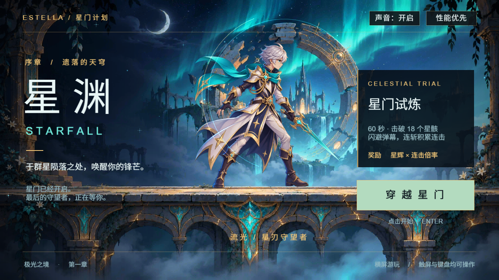

# 星渊 · STARFALL

基于 Estella 2D/3D 引擎的原生 2D 横屏动作演示，优先面向中端手机与微信小游戏。



动态星门大厅 → 传送入场 → 60 秒试炼 → 胜负结算 → 重试或返回大厅。手绘夜空、星刃守望者、悬浮星骸、连斩弧光、冲刺轨迹和星爆均在实际游戏中运行。场景、精灵、文字、按钮、摇杆、音频和输入使用 Estella；游戏逻辑不依赖 DOM。

## 操作

触屏：左侧摇杆移动；长按「斩」连续攻击；「闪」冲刺并短暂无敌；「跃」跳跃；「星爆」清除附近敌人与弹幕。星爆冷却 6 秒，冲刺冷却 1.1 秒。60 秒内击破 18 个星骸通关，生命归零或时间耗尽失败。

键盘：A / D 或方向键移动，J 连斩，K / 左 Shift 冲刺，空格 / W 跳跃，E 星爆，Enter 开始，Esc 暂停。右上角可关闭声音或切换节能模式。后台切换会暂停试炼，返回后手动继续。

## 导出与试玩

从仓库根目录运行，使用已构建的 Estella SDK 和引擎运行时：

```powershell
node pipeline/bin/estella.mjs export examples/starfall --out output/starfall/web --no-aot --json output/starfall/export-web.json
node examples/starfall/tools/preview.mjs
```

打开 `http://127.0.0.1:5194`。也可在 Estella 中打开本目录的 `project.esproject`。

微信小游戏：

```powershell
node pipeline/bin/estella.mjs export examples/starfall --platform wechat --out output/starfall/wechat --no-aot --enforce-budget --json output/starfall/export-wechat.json
```

将 `output/starfall/wechat` 导入微信开发者工具，填入自己的小游戏 AppID。项目没有绑定某个账号或已发布小游戏。引擎使用启动分包，图片在导出时缩小，背景转换为 KTX2，音效为短 PCM 文件。未使用的 3D、物理和骨骼资源不会作为场景资产打包。

## 性能设计与验收边界

- 世界画面以 1280×720 设计分辨率渲染，自动调整渲染比例；屏幕 UI 保持可读。宽屏保留完整的 16:9 游戏区域，按钮不被裁切。
- 无屏幕模糊、Bloom、动态阴影或重型后处理。复杂光影已绘入背景，运行时用少量批处理几何表现能量与星尘。
- 大厅和试炼共用一个场景与已加载资源；预先创建六个敌人精灵，切场没有贴图下载。文字字形以每帧 0.4 ms 的预算预热。
- 固定池上限：6 个敌人、24 发弹幕、160 个粒子、8 个音频声部。低档降至 80 个粒子，减少星尘并关闭震屏。
- 模拟采用 60 Hz 固定步长，每帧最多补算 3 步；暂停不推进战斗，触控取消释放虚拟输入。动态 HUD 只在内容变化时写入，常规刷新上限 5 Hz。

**60 FPS 是验收目标，不能用桌面结果替代微信真机保证。** 本次验证的环境、完整帧时间分布、绘制量和打包尺寸见 `source/verification.json`。无界面 Chromium 的手机视口和 4 倍 CPU 限速仍使用桌面 GPU，不模拟中端手机的 GPU、散热和微信运行时。

真机验收应记录手机型号、系统版本、微信基础库、默认/节能档位和设备温度，连续完成至少 10 分钟大厅、进场、反复星爆与重开，记录平均 FPS、P95/P99 帧时间、超过 33.3/50 ms 的帧、内存和切后台恢复。仅在指定设备与上述条件达标后，才能声称该设备稳定 60 帧。

## 无界面验证

```powershell
node sdk/node_modules/typescript/bin/tsc -p examples/starfall/tsconfig.json --noEmit
node --test examples/starfall/tools/game.test.mjs
node examples/starfall/tools/verify.mjs
node examples/starfall/tools/benchmark.mjs --enforce
```

验证脚本使用真正无界面的 Chromium，不启动编辑器或 Electron。它通过真实指针、按键和多点触控事件检查大厅、快速点按、移动、跳跃、技能、暂停、结算重试以及手机比例。性能脚本使用正常 Web 导出入口的真实 rAF 间隔和实际 WebGL 提交，记录大厅、首次进场、战斗与节能模式；测试工具不写入游戏状态。`--enforce` 对本次浏览器环境执行 FPS ≥ 58、P95 ≤ 20 ms、零超过 50 ms 帧和 P95 绘制提交 ≤ 32 的门槛，不代表真机认证。

`tools/build-scene.mjs` 可重建场景、资源元数据及原创合成音效。原始美术文件与提示词保存在 `assets/textures` 和 `source/art.json`、`source/sentinel-art.json`；运行时缩放由 Estella 导入设置完成。
